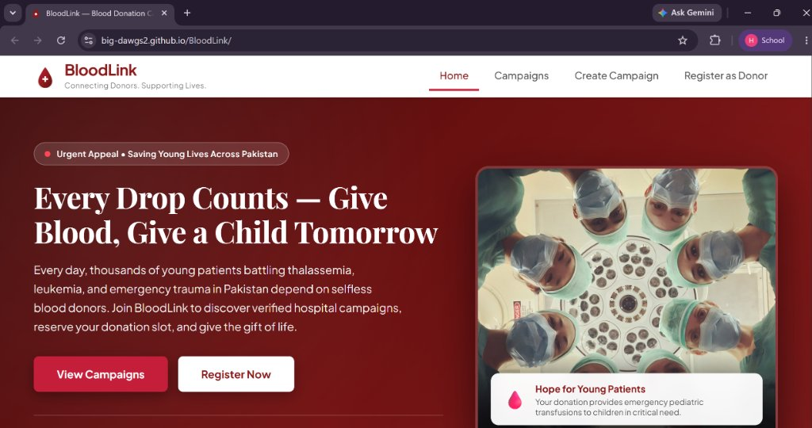
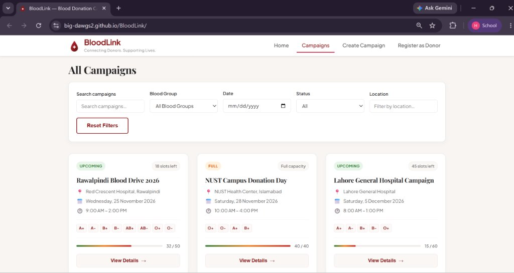
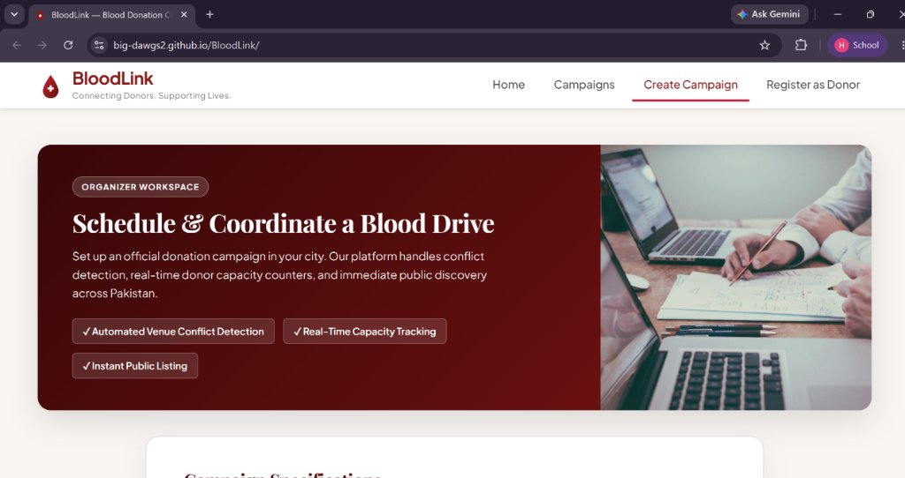
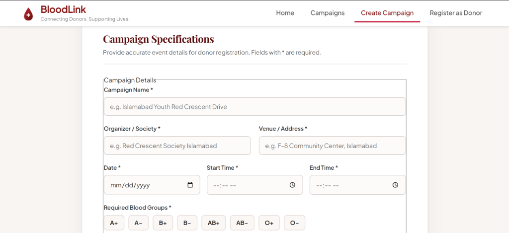
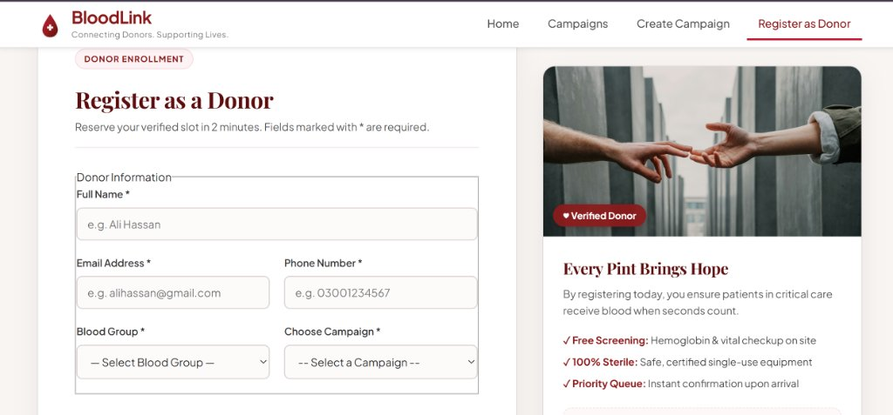
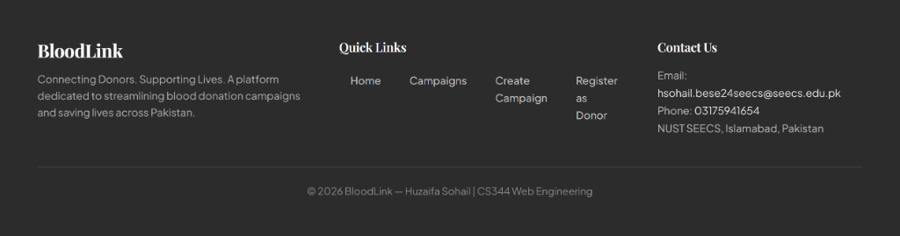

# CS344 Web Engineering — Formal Lab Report
## Assignment 1: Client-Side Web Application
### Project #21: Blood Donation Campaign Scheduler (BloodLink)

---

### Student & Project Metadata

| Field | Details |
|---|---|
| **Student Name** | Huzaifa Sohail |
| **Registration / Email** | `hsohail.bese24seecs@seecs.edu.pk` |
| **Contact Number** | `03175941654` |
| **Institution** | School of Electrical Engineering & Computer Science (SEECS), NUST |
| **Degree Program** | BS Software Engineering (BESE-24) |
| **Course** | CS344: Web Engineering (Fall 2026) |
| **Assigned Project** | Project #21 — Blood Donation Campaign Scheduler |
| **Platform Brand & Name** | **BloodLink** (*Connecting Donors. Supporting Lives.*) |
| **GitHub Repository** | [https://github.com/Big-DawGs2/BloodLink](https://github.com/Big-DawGs2/BloodLink) |
| **Live Deployed Website** | [https://big-dawgs2.github.io/BloodLink/](https://big-dawgs2.github.io/BloodLink/) |

---

## 1. Executive Summary & Problem Definition

Across Pakistan, thousands of young patients battling pediatric thalassemia, leukemia, and acute surgical trauma depend on life-saving blood transfusions every single day. Despite the generosity of voluntary donors, major logistical disconnects persist:
1. **Inefficient Campaign Discovery:** Donors often learn of local blood donation drives through sporadic flyers or unverified social media forwards, often after the drive has concluded.
2. **Venue & Schedule Clashes:** Independent organizations (Red Crescent, university welfare societies, private hospitals) unknowingly book the same community halls on the same date and overlapping hours.
3. **Capacity Mismanagement:** Walks-ins frequently overwhelm blood collection capacity at one drive, while neighboring campaigns suffer severe shortages.

**BloodLink** is an engineered client-side web application designed to solve these challenges. It establishes a centralized coordination environment allowing healthcare organizations to launch verified campaigns with automated venue conflict checking, while enabling potential donors to search regional drives, review medical requirements, and reserve their donation slots with real-time capacity feedback.

---

## 2. Technical Stack & Pedagogical Constraints

Per official course instructions (Lectures W01L01 through W05L11), the application strictly employs native web technologies with zero external UI frameworks or runtime dependencies:

| Architectural Layer | Technology Utilized | Pedagogical Justification (CS344 Syllabus) |
|---|---|---|
| **Structure & Semantics** | **HTML5** | Semantic elements (`<header>`, `<nav>`, `<main>`, `<section>`, `<article>`, `<aside>`, `<footer>`, `<fieldset>`, `<legend>`, `<label>`). Form accessibility attributes (`required`, `pattern`, `min`, `novalidate`). |
| **Presentation & Styling** | **CSS3 (Grid & Flexbox)** | Pure native stylesheets. CSS custom properties (`:root`), Flexbox toolbars, responsive CSS Grid layouts, and 2 distinct media-query breakpoints (`max-width: 768px` and `max-width: 480px`). Zero Bootstrap or Tailwind. |
| **Typography System** | **Google Web Fonts** | Authoritative editorial pairing: **`Playfair Display`** (700 bold serif for headings) and **`Plus Jakarta Sans` / `Inter`** (clean sans-serif for high legibility on high-DPI displays). |
| **Client-Side Engine** | **Vanilla JavaScript** | Clean ES5/ES6 modular scripts (`data.js`, `campaigns.js`, `donors.js`, `app.js`). Pure DOM event listeners, in-memory relational arrays, custom validation, and zero jQuery or React. |

---

## 3. Core Functional Modules & Architecture

### 3.1 Dynamic Single-Page Application (SPA) Routing
The application functions as a cohesive Single-Page Application. Rather than triggering disruptive HTTP page reloads, navigation links dynamically manipulate the CSS class list (`.active` and `.hidden`) of top-level sections (`#hero`, `#campaigns`, `#createCampaignSection`, `#registerSection`). This architecture preserves client memory state across views and guarantees instantaneous UI transitions.

### 3.2 Dynamic In-Memory Relational Data Store (`data.js`)
The application is pre-seeded with 8 comprehensive Pakistani campaigns, 8 registered donors, and 25 relational registration records:
- **Campaign Entity:** `id`, `name`, `organizer`, `location`, `date`, `startTime`, `endTime`, `bloodGroups` (array), `capacity`, `registeredCount`, `contact`, `description`, `status`.
- **Donor Entity:** `id`, `name`, `email`, `phone`, `bloodGroup`.
- **Registration Junction Entity:** `id`, `campaignId`, `donorId`, `registrationDate`, `status`.

### 3.3 Dynamic Status Derivation & Capacity Metering
Campaign statuses are calculated dynamically on each render:
- `Upcoming`: Valid future calendar date with remaining donor slots (`registeredCount < capacity`).
- `Full`: Registered count has reached or exceeded max capacity (`registeredCount >= capacity`).
- `Completed`: Campaign date precedes the current system date.

Capacity percentage is rendered through a progress bar:
$$\text{Fill Percentage} = \min\left(100, \left\lfloor \frac{\text{registeredCount}}{\text{capacity}} \times 100 \right\rfloor\right)$$

### 3.4 Spatial & Temporal Conflict Engine (`campaigns.js`)
To safeguard organizer venue reservations, BloodLink enforces an automated conflict detection algorithm:
$$\text{Conflict} \iff (\text{Location}_A = \text{Location}_B) \land (\text{Date}_A = \text{Date}_B) \land (\text{Start}_A < \text{End}_B) \land (\text{End}_A > \text{Start}_B)$$
If a newly submitted campaign clashes with an existing booking at the same location and overlapping hours, the form submission is aborted, and a toast alert identifies the conflicting campaign and hours. Non-overlapping hours (e.g., morning 09:00–12:00 vs. afternoon 13:00–17:00) at the same venue are permitted.

### 3.5 Volunteer Donor Registration & Capacity Guard (`donors.js`)
- Enforces non-empty input checks and strict Pakistani mobile number formatting (`03XX-XXXXXXX` or `+923XX-XXXXXXX`).
- **Duplicate Prevention:** Inspects existing registrations for the target campaign to ensure an email cannot be registered more than once for the same drive.
- **Capacity Lockout:** Instantly disables registration submissions if a campaign has reached `Full` capacity or is marked `Completed`.

---

## 4. Visual Evidence & Interface Walkthrough

Below are the official visual verification screenshots of BloodLink captured directly from the live deployed application.

---

### Screenshot 1: Interactive Home Page & Hero Section


- **UI Component:** `#hero` (Home View)
- **Technical Description:**
  - **Brand Identity & Header:** Displays the sticky navigation bar featuring the custom BloodLink droplet logo, title, and tagline (*"Connecting Donors. Supporting Lives."*), alongside navigational links to Home, Campaigns, Create Campaign, and Register as Donor.
  - **Hero Layout:** A 2-column asymmetric layout with deep burgundy gradient branding.
  - **Urgent Appeal Badge:** Includes an animated pulsing indicator (`.badge-pulse`) highlighting life-saving efforts across Pakistan.
  - **Call-to-Action Buttons:** Prominently presents the crimson **"View Campaigns"** button and the crisp, high-contrast white **"Register Now"** button (`.btn-hero-secondary`) with bold dark burgundy typography.
  - **Pediatric Healthcare Visual:** Embedded `hero-child-transfusion.jpg` with a floating glassmorphic caption card (*"Hope for Young Patients: Your donation provides emergency pediatric transfusions to children in critical need"*).

---

### Screenshot 2: Campaigns Directory & Real-Time Filter Bar


- **UI Component:** `#campaigns` (All Campaigns Section)
- **Technical Description:**
  - **Multi-Parameter Filter Toolbar:** Provides instantaneous live client-side filtering by:
    1. *Search campaigns* (case-insensitive substring on title).
    2. *Blood Group dropdown* (`A+`, `A-`, `B+`, `B-`, `AB+`, `AB-`, `O+`, `O-`).
    3. *Date Picker* (exact calendar match).
    4. *Status dropdown* (`Upcoming`, `Full`, `Completed`).
    5. *Location search* (case-insensitive substring on city/venue).
    6. *Reset Filters button* to clear state.
  - **Minimalist Campaign Cards:** Rendered using `.campaign-card.minimal-card` containing status pills (green `UPCOMING`, orange `FULL`), slot availability counter pills (`18 slots left`, `Full capacity`), venue location, event date, active time window, required blood group badges, color-graded capacity progress bar, and a interactive `View Details →` drill-down button.

---

### Screenshot 3: Organizer Workspace Header Banner


- **UI Component:** Top banner of `#createCampaignSection`
- **Technical Description:**
  - **Organizer Identity Header:** Displays the dedicated `.create-header-banner` card featuring an `ORGANIZER WORKSPACE` pill badge.
  - **Value Proposition & Operational Perks:** Clearly enumerates three key technical perks of BloodLink's scheduling platform:
    1. `✓ Automated Venue Conflict Detection`
    2. `✓ Real-Time Capacity Tracking`
    3. `✓ Instant Public Listing`
  - **Distinct Visual Asset:** Employs `organizer-planning.jpg` showing clinical coordinators reviewing logistics, reinforcing a professional administrative workspace aesthetic distinct from the public donor portal.

---

### Screenshot 4: Campaign Specification Form & Blood Group Chips


- **UI Component:** `#campaignForm` inside `.create-form-container`
- **Technical Description:**
  - **Structured Input Grid:** Captures *Campaign Name*, *Organizer / Society*, *Venue / Address*, *Date*, *Start Time*, and *End Time*.
  - **Interactive Blood Group Chips:** Replaces standard browser checkboxes with custom styled interactive toggle chips (`.blood-chip`). Selected blood groups highlight in dark crimson with bold white lettering and elevation.
  - **Validation & Submission:** Features target donor capacity input and emergency phone validation. On form submission, the JavaScript engine performs spatial/temporal conflict verification and chronological validation (`endTime > startTime`) prior to committing the new record to memory.

---

### Screenshot 5: Volunteer Donor Registration Portal


- **UI Component:** `#registerSection` (`.donor-layout-grid`)
- **Technical Description:**
  - **2-Column Asymmetric Registration View:**
    - **Left (Registration Form):** Streamlined input card accepting *Full Name* (`e.g. Ali Hassan`), *Email Address* (`e.g. alihassan@gmail.com`), *Phone Number* (`e.g. 03001234567`), *Blood Group dropdown*, and active *Campaign selector*.
    - **Right (Verified Donor Identity Card):** Prominently displays `donor-card-badge.jpg` featuring a floating `♥ Verified Donor` pill, a reassuring on-site screening checklist (*Free Screening*, *100% Sterile*, *Priority Queue*), and an impact metric circle indicating the 3 patient lives benefited by the single donation.

---

### Screenshot 6: Site Footer & Institutional Attribution


- **UI Component:** `.site-footer`
- **Technical Description:**
  - **3-Column Grid Layout:** Built using semantic HTML5 (`<footer>`, `<address>`).
  - **Brand Column:** Restates the platform mission and identity.
  - **Quick Links Navigation:** SPA-friendly links to all primary application sections.
  - **Verified Contact Address:** Displays student email (`hsohail.bese24seecs@seecs.edu.pk`), student phone number (`03175941654`), and institutional affiliation (`NUST SEECS, Islamabad, Pakistan`).
  - **Copyright & Academic Attribution:** Formal copyright notice establishing academic attribution for CS344 Web Engineering.

---

## 5. Architectural Continuity & Migration Roadmap

A defining requirement of this three-stage project is establishing a rock-solid foundation for future extensions:

```
[Assignment 1 (Current)]       [Assignment 2 (PHP 8.5 & SQL)]      [Assignment 3 (MERN Stack)]
HTML5 + CSS3 + Vanilla JS  ──> PHP 8.5 PDO + MySQL / SQLite   ──>  React.js + Express + MongoDB
In-Memory Client Arrays        Relational Schema & JSON APIs       NoSQL Documents & REST APIs
Client Form Validation         Server-Side PDO & Prepared Stmt     JWT Auth & Role-Based Guard
```

### Transition to Assignment 2 (PHP 8.5 & Relational Database)
1. **Schema Portability:** The in-memory data models (`campaigns`, `donors`, `registrations`) map directly to SQL relational tables with foreign key constraints (`campaign_id` $\rightarrow$ `registrations.campaign_id`).
2. **Endpoint Transition:** The JavaScript functions `createCampaign()`, `filterCampaigns()`, and `registerDonor()` will be converted into asynchronous `fetch()` calls communicating with server-side PHP endpoints (`api/campaigns.php`, `api/register.php`) returning JSON payloads.
3. **Server Security:** Client-side validation rules will be mirrored with authoritative PHP server-side validation, PDO prepared statements for SQL injection prevention, and session CSRF tokens.

### Transition to Assignment 3 (MERN Stack)
1. **Componentization:** The SPA sections (`#hero`, `#campaigns`, `#createCampaignSection`, `#registerSection`) will be refactored into reusable React functional components with reactive state (`useState`, `useEffect`).
2. **Backend API:** An Express.js REST server will replace PHP endpoints, interfacing with MongoDB collections via Mongoose models.
3. **Role-Based Access Control (RBAC):** Implementation of JSON Web Tokens (JWT) allowing organizers to manage campaigns under verified authentication while donors manage personal booking profiles.

---

## 6. Verification & Test Execution Summary

The application has been verified against 14 formal test cases documented in `documentation/test-cases.md`. All tests achieved a **100% Pass Rate**:

| Test ID | Objective | Input / Action | Observed Behavior | Status |
|---|---|---|---|---|
| **TC-01** | Initial Data & Metric Rendering | Page Load | 8 campaigns, 5 upcoming, 25 registrations, 218 slots rendered dynamically | ✅ PASS |
| **TC-02** | Text Substring Search | Query "Islamabad" | Isolates matching campaigns in Islamabad | ✅ PASS |
| **TC-03** | Blood Group Filter | Select "O+" | Filters campaigns requesting O+ blood | ✅ PASS |
| **TC-04** | Status Filter | Select "Full" | Displays only CAM-002 (NUST Campus Donation Day) | ✅ PASS |
| **TC-05** | Reset Filters Action | Click "Reset Filters" | Clears inputs and restores full 8-campaign gallery | ✅ PASS |
| **TC-06** | Details Modal Inspection | Click "View Details" | Opens modal with complete donor list; closes on `Escape` key | ✅ PASS |
| **TC-07** | Campaign Creation | Submit valid form | Appends new campaign, recalculates dashboard stats without page reload | ✅ PASS |
| **TC-08** | Date & Time Boundary Guard | Enter past date / `end < start` | Form blocks submission with inline error message | ✅ PASS |
| **TC-09** | Spatial & Temporal Conflict | Overlapping drive at same venue | Conflict engine detects clash and blocks scheduling | ✅ PASS |
| **TC-10** | Permitted Same-Venue Slot | Non-overlapping time at same venue | Successfully scheduled | ✅ PASS |
| **TC-11** | Donor Slot Reservation | Valid donor registration | Decrements available slots and updates registered counter | ✅ PASS |
| **TC-12** | Duplicate Email Prevention | Re-register same email for campaign | Blocks duplicate registration with explanatory alert | ✅ PASS |
| **TC-13** | Capacity Lockout | Attempt registration on full drive | Blocked with capacity limit warning | ✅ PASS |
| **TC-14** | Responsive Viewport Check | Resize to 768px & 480px | Menu collapses to hamburger; cards and forms stack seamlessly | ✅ PASS |

---

## 7. Official Project Links & Access

- **GitHub Source Code Repository:**  
  [https://github.com/Big-DawGs2/BloodLink](https://github.com/Big-DawGs2/BloodLink)

- **Live Deployed Demonstration Website (GitHub Pages):**  
  [https://big-dawgs2.github.io/BloodLink/](https://big-dawgs2.github.io/BloodLink/)

---

## 8. Conclusion

**BloodLink** successfully demonstrates the rigorous application of modern web engineering principles. By prioritizing semantic HTML5, disciplined CSS3 box modeling and responsive layouts, and robust vanilla JavaScript DOM manipulation, the application delivers a polished, accessible, and high-performance client-side solution. It serves as an exemplary academic submission for Assignment 1 and an architectural springboard for Assignments 2 and 3.

---
**Report Compiled by:** Huzaifa Sohail (BESE-24)  
*Department of Software Engineering, SEECS, NUST*  
*Fall 2026*
