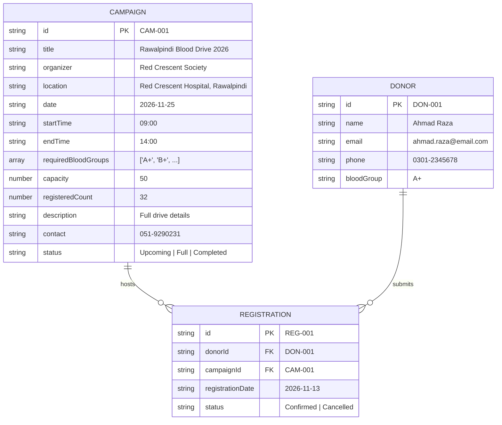

# BloodLink — Core Data Model & Future Database Specification
**Course:** CS344 Web Engineering — Assignment 1 (Fall 2026)  
**Project #21:** Blood Donation Campaign Scheduler  
**Student:** Huzaifa Sohail  

---

## 1. Data Model Overview

The BloodLink application is designed around three normalized core entities:
1. **Campaign:** The blood donation event scheduled at a specific venue, date, and time.
2. **Donor:** The individual volunteer wishing to donate blood.
3. **Registration:** The associative entity linking a Donor to a specific Campaign.

This normalized structure guarantees that donor profiles are not redundantly duplicated across multiple campaigns, and campaign statistics can be derived or reconciled with mathematical certainty.

---

## 2. Entity-Relationship Diagram (ERD)



---

## 3. Entity Specifications (Assignment 1 Implementation)

### 3.1 Campaign Entity
| Property | Type | Constraints | Description |
|---|---|---|---|
| `id` | String | PK, Pattern: `CAM-XXX` | Unique campaign identifier |
| `title` | String | Required, Min 3 chars | Official campaign title |
| `organizer` | String | Required | Host organization or hospital |
| `location` | String | Required | Venue / physical location |
| `date` | String | Required, ISO `YYYY-MM-DD` | Date of the campaign |
| `startTime` | String | Required, 24h `HH:MM` | Event starting time |
| `endTime` | String | Required, 24h `HH:MM`, > `startTime` | Event closing time |
| `requiredBloodGroups` | Array<String> | Min 1 selection | Array of needed blood groups |
| `capacity` | Number | Integer, Min 1 | Maximum allowable donor slots |
| `registeredCount` | Number | Integer, $\ge 0$ | Current number of booked slots |
| `description` | String | Required, Min 10 chars | Detailed drive briefing |
| `contact` | String | Required | Phone number or official contact email |
| `status` | String | `'Upcoming' \| 'Full' \| 'Completed'` | Computed event availability state |

### 3.2 Donor Entity
| Property | Type | Constraints | Description |
|---|---|---|---|
| `id` | String | PK, Pattern: `DON-XXX` | Unique donor identifier |
| `name` | String | Required, Min 2 chars | Full legal name of donor |
| `email` | String | Required, Valid email regex | Primary contact and unique email |
| `phone` | String | Required, Pakistani tel regex | Contact number (e.g., `03175941654`) |
| `bloodGroup` | String | One of 8 valid ABO/Rh groups | `A+`, `A-`, `B+`, `B-`, `AB+`, `AB-`, `O+`, `O-` |

### 3.3 Registration Entity
| Property | Type | Constraints | Description |
|---|---|---|---|
| `id` | String | PK, Pattern: `REG-XXX` | Unique registration receipt ID |
| `donorId` | String | FK -> `donors.id` | Reference to registered donor |
| `campaignId` | String | FK -> `campaigns.id` | Reference to targeted campaign |
| `registrationDate` | String | ISO `YYYY-MM-DD` | Date when registration occurred |
| `status` | String | `'Confirmed' \| 'Cancelled'` | Registration status |

---

## 4. Referential Integrity & Consistency Rules

1. **Capacity Enforcement:**
   $$\text{Available Slots} = \text{capacity} - \text{registeredCount}$$
   If $\text{registeredCount} \ge \text{capacity}$, the campaign automatically transitions to `'Full'` and blocks new registrations.
2. **Duplicate Registration Prevention:**
   A donor with a given email cannot register more than once for the same campaign:
   $$\forall r \in \text{Registrations}, \neg(r.\text{campaignId} = C \land \text{Donor}(r.\text{donorId}).\text{email} = E)$$
3. **Cascading Deletion:**
   When an organizer deletes a campaign via `deleteCampaign(campaignId)`, all linked registration records in `registrations` are cleanly purged to prevent orphaned references.

---

## 5. Future Stage Mapping: Relational Schema (Assignment 2 - PHP 8.5 & PDO)

In Assignment 2, this in-memory data model maps directly to SQL tables with Foreign Key constraints and Prepared Statements:

```sql
-- SQLite / MySQL Schema for Assignment 2
CREATE TABLE donors (
    id VARCHAR(16) PRIMARY KEY,
    name VARCHAR(100) NOT NULL,
    email VARCHAR(120) NOT NULL UNIQUE,
    phone VARCHAR(20) NOT NULL,
    blood_group VARCHAR(5) NOT NULL,
    created_at TIMESTAMP DEFAULT CURRENT_TIMESTAMP
);

CREATE TABLE campaigns (
    id VARCHAR(16) PRIMARY KEY,
    title VARCHAR(150) NOT NULL,
    organizer VARCHAR(100) NOT NULL,
    location VARCHAR(200) NOT NULL,
    event_date DATE NOT NULL,
    start_time TIME NOT NULL,
    end_time TIME NOT NULL,
    required_blood_groups TEXT NOT NULL, -- JSON-encoded or comma-separated
    capacity INT NOT NULL CHECK(capacity > 0),
    description TEXT NOT NULL,
    contact VARCHAR(50) NOT NULL,
    status VARCHAR(20) NOT NULL DEFAULT 'Upcoming',
    created_at TIMESTAMP DEFAULT CURRENT_TIMESTAMP
);

CREATE TABLE registrations (
    id VARCHAR(16) PRIMARY KEY,
    donor_id VARCHAR(16) NOT NULL,
    campaign_id VARCHAR(16) NOT NULL,
    registration_date DATE NOT NULL,
    status VARCHAR(20) NOT NULL DEFAULT 'Confirmed',
    FOREIGN KEY (donor_id) REFERENCES donors(id) ON DELETE CASCADE,
    FOREIGN KEY (campaign_id) REFERENCES campaigns(id) ON DELETE CASCADE,
    UNIQUE(donor_id, campaign_id)
);
```

---

## 6. Future Stage Mapping: Document Schema (Assignment 3 - MERN)

In Assignment 3, these entities transition seamlessly into Mongoose schema documents:

```javascript
// Campaign Document (MongoDB)
const CampaignSchema = new mongoose.Schema({
    title: { type: String, required: true },
    organizer: { type: String, required: true },
    location: { type: String, required: true },
    date: { type: Date, required: true },
    startTime: { type: String, required: true },
    endTime: { type: String, required: true },
    requiredBloodGroups: [{ type: String, enum: ['A+','A-','B+','B-','AB+','AB-','O+','O-'] }],
    capacity: { type: Number, required: true, min: 1 },
    registeredCount: { type: Number, default: 0 },
    description: { type: String, required: true },
    contact: { type: String, required: true },
    status: { type: String, enum: ['Upcoming', 'Full', 'Completed'], default: 'Upcoming' },
    createdBy: { type: mongoose.Schema.Types.ObjectId, ref: 'User' }
}, { timestamps: true });

// Registration Document (MongoDB)
const RegistrationSchema = new mongoose.Schema({
    donor: { type: mongoose.Schema.Types.ObjectId, ref: 'Donor', required: true },
    campaign: { type: mongoose.Schema.Types.ObjectId, ref: 'Campaign', required: true },
    registrationDate: { type: Date, default: Date.now },
    status: { type: String, enum: ['Confirmed', 'Cancelled'], default: 'Confirmed' }
}, { timestamps: true });
```
